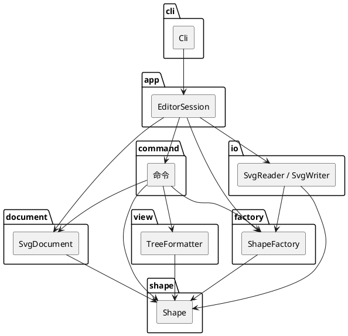

# Lab1 Phase 1 架构说明

## 架构方案

### 1. 模块划分

| 目录 | 职责 |
|---|---|
| `src/cli` | REPL：横幅、提示符、把一行交给会话。不解析图形，不改文档。 |
| `src/app` | 组合根。`EditorSession` 持有文档、历史、工厂和文件读写；`CommandTokenizer` 只切词。 |
| `src/command` | 一条命令一个类。编辑命令实现 `execute` / `undo`；显示命令和文档命令不进撤销栈。 |
| `src/document` | 当前 SVG 文档：画布尺寸、id 索引、挂载 / 摘除 / 换父。 |
| `src/shape` | 图形层次。叶子与 `g` 都是 `Shape`，容器操作走多态。 |
| `src/factory` | 类型名到图形类。本阶段只注册六种内置类型。 |
| `src/io` | XML 解析、SVG 读写、文件读写。图形对象不依赖这里。 |
| `src/view` | `tree` 的对齐排版。 |
| `src/util`、`src/error` | 数字格式、XML 转义、统一错误。不依赖上层。 |
| `test` | 对照作业 transcript 和错误表的自动化检查。 |
| `examples` | 作业第 6 节的 `other.svg`。 |

一类一文件，文件名等于类名。字段私有，命令和文档通过方法改状态，没有对外暴露的数据袋。

源文件副本：`doc/architecture.puml`。

### 2. 设计模式

**Command（作业要求）。** `MoveCommand`、`CreateCommand`、`GroupCommand` 等各自是一个撤销单元。`CommandHistory.push` 时清空 redo 并解除 IO 锁；`undo` / `redo` 只调用该对象的 `undo()` / `execute()`。几何类命令在构造时拍 `GeometrySnapshot`，undo 恢复快照，redo 再执行一次，不在 redo 时重新拍照。`group` / `ungroup` / `addto` / `delete` 也是一条命令对应一次撤销。

**Composite。** `GroupShape` 与叶子都实现 `move` / `scale` / `set` / `delete` 用到的接口。组的移动和缩放递归到子孙，不写 SVG `transform`。`tree`、`show`、序列化都走多态，没有 `switch(tag)`。

**Factory。** `ShapeFactory` 按类型名创建图形。未知类型报 `unknown shape type: <name> (is the plugin loaded?)`。

没有用 Visitor。作业后半段要加的是新图形类型（`box` 插件），并且要求内核新增代码为 0。Visitor 每加一种图形就要改访问者，扩展方向反了。新行为放在 `Shape` 子类上。

### 3. 依赖方向

允许的方向是自上而下：

- `cli` → `app`
- `app` → `command`、`document`、`factory`、`io`、`error`
- `command` → `document`、`shape`、`factory`、`view`、`io`（仅读写命令）、`util`、`error`。命令通过 `AppContext` 拿文档和历史，不反向依赖 `EditorSession` 具体类，避免环。
- `document` → `shape`、`error`
- `factory` → `shape`、`error`
- `io` → `shape`、`factory`、`document`、`util`、`error`
- `view` → `shape`、`document`、`util`
- `shape` → `util`、`error`。图形不读文件，也不解析 XML 文档。
- `util` / `error` 不依赖任何业务模块。

`Shape` 与 `GroupShape` 的循环用 `import type` 和 `ChildOwner` 打断，运行时不互相 import 类型以外的符号。帮助文本放在 `command/`，分词放在 `app/`，这样命令模块不依赖 CLI。

**待重构的按名字分派只有两处**，代码里标了 `TODO(refactor)`：

1. `CommandRegistrar`：命令名 → 处理函数。
2. `ShapeFactory`：类型名 → 类。

### 4. 变化点

| 变化点 | 怎么留的 | 为什么这样 |
|---|---|---|
| 新图形类型，尤其 `box` | 工厂是唯一创建入口；未知类型已按插件口吻报错。`GroupShape.markComposite` 让 `ungroup` 能拒绝复合图形。写出时若被标成复合类型，会带 `data-kind`。 | 本阶段不实现 `box`。插件接口还没要求落地，先留拒绝解散和序列化标记，避免以后改 `ungroup` 的判断方式。 |
| 读回带 `data-kind` 的文件 | `SvgReader` 忽略 `data-kind`，当成普通 `g`，不调用 `markComposite`。 | 作业写明：没装插件就降级，不丢子图形。本阶段没有插件可还原。 |
| 新编辑命令 | 新类 + 在 `CommandRegistrar` 注册。撤销协议已固定。 | 命令表还会长，但分派点不能再增加。 |
| 树的显示列宽 | `TreeFormatter` 按「有明细的行里，前缀+标签的最大长度 + 2」对齐。 | 第 5、6 节示例都是这一列。6.1 流程图示例是手排到更宽的列，最长标签还会溢出，不单独特殊处理。 |
| IO 之后能不能撤销 | 成功的 `init` / `read` 换文档并清空且上锁；成功的 `save` / 改尺寸 `canvas` 只上锁、保留历史。下一次成功的编辑命令解锁。失败的命令在改状态或上锁之前抛错。 | 作业要求失败不改变任何状态，所以失败的 `read` / `save` 不能把撤销锁上。 |

明确不留的：

- 不实现 `ShapeProvider` / `create box`。作业把插件化划到下一阶段，本阶段实现等于超范围，也会多一处名字分派。
- 不用 SVG `transform` 表示移动和缩放。作业要求因子乘到几何属性上，组则递归。
- 不把属性列做成可配置。当前只有一套 transcript 要对齐。

## 过程记录

对照作业文本和生成代码，改过这些点：

1. **树的空格。** 第一版列号是「前缀+标签最大值 + 1」，比第 5、6 节少一格。用示例逐行量过：有明细的最长行是 17 个码点，属性从第 19 列开始，所以是 +2。6.1 的流程图被手排到第 29 列，`text#process-label` 还会再溢出；若为了贴那一张图去写死列宽，第 6 节就会错。测试对第 6 节做整段相等，对流程图只检查内容。
2. **失败的 IO 不锁撤销。** 草稿测试在 `read missing.svg` 失败后期望 `undo not allowed after io command`。这和「失败不改变状态」矛盾：`init` 之后已经有一次成功的 `create`，失败的 `canvas` / `save` / `read` 不应上锁。实现保持「成功才上锁」，测试改成撤销仍能去掉那次 `create`。成功 `save` 和成功改尺寸之后的锁定，由第 6 节和另一条测试覆盖。`init` 刚结束时栈是空的，但锁优先，所以报的是 IO 错误而不是 `nothing to undo`。
3. **叶子和组的 move 文案不同。** 叶子是 `moved to (x,y)`，组是 `moved by (dx,dy)`。作业正文没有单列这条，但第 6 节和第 6.1 节的回显就是这样。缩放两边都用 `scaled by` / `scaled back by`。
4. **线的树明细不带 stroke。** 6.1 的示例只有 `(x1,y1) -> (x2,y2)`。stroke 仍会出现在 `show` 和 SVG 里。
5. **`addto` 参数顺序是容器在前、图形在后**，与命令表一致。组合成员不必是兄弟；新组插在文档序第一个成员原来的位置。
6. **依赖方向。** 一度把 XML 转义和帮助文本放进 `io` / `cli`，图形和命令会反过来依赖它们。转到 `util/XmlCodec` 和 `command/HelpText`，并删掉重复文件。`shape` 不引用 `io`。
7. **不用 Visitor。** 生成方案里出现过用访问者遍历图形。作业下一变化是新类型且内核为零修改，访问者会迫使内核改接口，已去掉。
8. **`box` 只留钩子。** 读入不把 `data-kind="box"` 提升成复合类型，否则没装插件也会拒绝 `ungroup`，和降级决策相反。

## 一致性自查

1. **模块划分。** 实际目录与上表一致。曾多出 `src/cli/HelpText.ts`、`src/cli/CommandTokenizer.ts` 和 `src/io/XmlCodec.ts` 三份重复文件，已删除，不保留第二份实现。
2. **依赖方向。** 抽查：`Shape.ts`、`GroupShape.ts` 只引用 `util` 和同层类型；`SvgReader` 通过工厂建图形，不在 reader 里按标签 `switch`；`HelpCommand` 引用 `command/HelpText`，不引用 `cli`。两处名字分派都在方案里标为待重构，没有第三处。`create box` 仍走工厂的未知类型错误，没有偷偷实现插件。

## 质量保证手段

- `npm test`：Node 自带测试运行器。覆盖第 6 节整段回显（含树、撤销、保存个数、读入警告和 7 个元素的树）、流程图文案、错误表、失败不改文档、IO 锁、redo 被新编辑清掉、组缩放递归、front/back、ungroup、id 大小写、`data-kind` 降级、带引号文本的往返，以及 CLI 进程的横幅和 `init`。
- `npm run build`：`tsc --noEmit`，`strict`。
- 失败命令在写文档或上锁之前抛 `EditorError`，会话捕获后只打印 `error:`，不把异常状态留下来。
- 保存结果可用浏览器直接打开。属性顺序是写出器自己的顺序，不承诺与源文件属性顺序相同。
